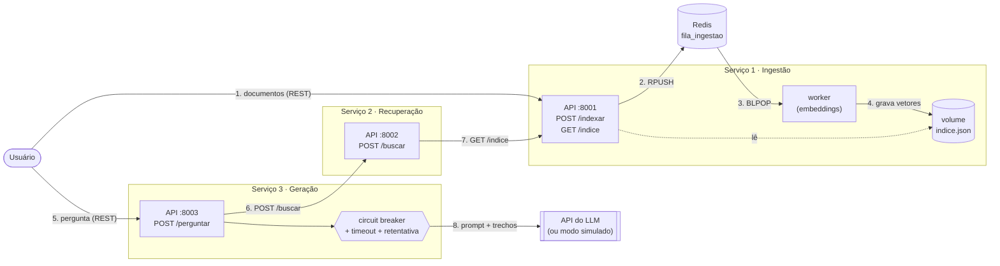

# RAG Distribuído em Microsserviços — C2.A2

**Sistemas Distribuídos e Computação em Nuvem · FAESA · 2026/2 · Prof. Howard Cruz Roatti**

Grupo: Gabriel Silva, Julia Evellyn, Jonathan Barroso e Maurilio Marques.

Sistema de perguntas e respostas com recuperação (RAG) sobre um conjunto de documentos,
decomposto em **três microsserviços independentes** que conversam por **REST**, com uma
**fila (Redis)** na etapa de ingestão e **circuit breaker + tempo-limite + retentativa**
na chamada ao LLM. Feito a partir do [kit da disciplina](https://github.com/howardroatti/sd-2026-2-kit-c2a2).

---

## Arquitetura



Versão em texto, caso o diagrama não seja exibido:

```
                    ┌──────────────── Serviço 1 · Ingestão ────────────────┐
 documentos ──REST──► API :8001 ──RPUSH──► [ Redis: fila_ingestao ] ──BLPOP──► worker
                    │    ▲                                                  │  │
                    │    └──────────── lê ──── indice.json (volume) ◄─grava─┘  │
                    └──────────────────────────────────────────────────────────┘
                              ▲ GET /indice
                              │
 pergunta ──REST──► Serviço 3 · Geração :8003 ──POST /buscar──► Serviço 2 · Recuperação :8002
                         │
                         └── disjuntor + timeout + retentativa ──► LLM (API ou modo simulado)
```

| Serviço | Porta | Responsabilidade | Arquivos |
|---|---|---|---|
| **Ingestão** (API) | 8001 | Recebe documentos e os **enfileira** (responde 202 na hora). Serve o índice. | `servicos/ingestao/app.py` |
| **Ingestão** (worker) | — | **Consome a fila**, gera os embeddings (TF-IDF) e grava o índice em disco. | `servicos/ingestao/worker.py`, `indice.py`, `fila.py` |
| **Recuperação** | 8002 | Vetoriza a pergunta e devolve os `top_k` trechos mais parecidos (similaridade do cosseno). | `servicos/recuperacao/app.py` |
| **Geração** | 8003 | Busca os trechos, monta o prompt e chama o LLM com resiliência. | `servicos/geracao/app.py` |
| **Redis** | 6379 | Fila de mensagens entre a API de ingestão e o worker. | `docker-compose.yml` |

---

## Como executar do zero

Pré-requisito: **Docker** (Docker Desktop no Windows/macOS). Não precisa de chave de LLM nem de internet: sem
`LLM_API_KEY` o sistema roda em **modo simulado**.

```bash
git clone https://github.com/GabrielSHerculino/sd-2026-2-kit-c2a2.git
cd sd-2026-2-kit-c2a2

docker compose up --build -d          # sobe redis, ingestao, worker, recuperacao e geracao
docker compose ps                     # os 5 servicos "Up" (redis "healthy")

# indexa os documentos de exemplo da pasta documentos/ (passam pela fila)
docker compose exec ingestao python -m servicos.ingestao.carregar
```

Pergunte:

```bash
curl -X POST http://localhost:8003/perguntar -H "Content-Type: application/json" \
  -d '{"pergunta":"o que diz o teorema CAP?"}'
```

No PowerShell (Windows):

```powershell
Invoke-RestMethod -Method Post "http://localhost:8003/perguntar" -ContentType "application/json" -Body '{"pergunta":"o que diz o teorema CAP?"}' | Format-List
```

Resposta esperada: `resposta` começando com `[MODO SIMULADO ...]` e `contexto` com o trecho do teorema CAP em
primeiro lugar. A documentação interativa (Swagger) fica em `http://localhost:8001/docs`, `:8002/docs` e `:8003/docs`.

Para desligar: `docker compose down` (use `docker compose down -v` para apagar também o índice salvo).

### Usar um LLM de verdade (opcional)

Copie `.env.example` para `.env` e preencha `LLM_API_KEY` (e, se for o caso, `LLM_API_URL` e `LLM_MODELO`).
Depois rode `docker compose up -d geracao` para recriar o serviço de geração. O compose lê o `.env` sozinho e passa
essas variáveis para o container (veja `environment` do serviço `geracao` no `docker-compose.yml`).
**A chave nunca fica no código nem na imagem**: o `.env` está no `.gitignore` e no `.dockerignore`.

### Rodar sem Docker (desenvolvimento)

```bash
python -m venv .venv && source .venv/bin/activate      # Windows: .venv\Scripts\activate
pip install -r requirements.txt
docker compose up -d redis                              # a fila continua precisando do Redis

uvicorn servicos.ingestao.app:app    --port 8001        # um terminal para cada
python -m servicos.ingestao.worker
uvicorn servicos.recuperacao.app:app --port 8002
uvicorn servicos.geracao.app:app     --port 8003

python -m servicos.ingestao.carregar
```

Fora do Docker o `.env` não é lido: sem nada definido, o LLM roda em modo simulado. Para usar uma chave, defina
`LLM_API_KEY` no terminal da geração antes de subir o `uvicorn`.

---

## Endpoints

| Método e rota | Entrada | Saída |
|---|---|---|
| `POST :8001/indexar` | `[{"texto": "...", "origem": "..."}]` | **202** `{"enfileirados", "na_fila"}` · 503 se o Redis estiver fora. Reenviar a mesma `origem` substitui o documento |
| `GET :8001/indice` | — | `{"total", "itens": [{"texto", "origem", "vetor"}]}` |
| `DELETE :8001/indice` | — | `{"total": 0}` (zera o índice, para testes) |
| `GET :8001/saude` | — | documentos, `fila_redis`, `na_fila`, `dead_letter` |
| `POST :8002/buscar` | `{"pergunta", "top_k"}` | `{"resultados": [{"texto", "origem", "pontuacao"}]}` |
| `POST :8003/perguntar` | `{"pergunta"}` | `{"pergunta", "resposta", "contexto"}` · 503 se recuperação ou LLM indisponíveis |
| `GET :8003/saude` | — | estado de `disjuntor_llm` e `disjuntor_recuperacao` |

---

## Resiliência

**Chamada ao LLM** (`servicos/geracao/app.py`), as três defesas juntas:

1. **Tempo-limite**: cada chamada ao LLM desiste após `LLM_TIMEOUT` segundos (padrão 20, em `servicos/comum/llm.py`).
2. **Retentativa com espera crescente**: `_gerar_com_retentativa` tenta até `LLM_TENTATIVAS` vezes (padrão 3),
   esperando 1 s e depois 2 s. Repetir é seguro porque gerar uma resposta é **idempotente** (não altera nada).
3. **Circuit breaker**: a função com retentativa roda **dentro** do disjuntor, então ele conta uma falha só quando
   todas as tentativas se esgotam. Após 3 falhas ele **abre** e recusa na hora por 20 s; depois deixa uma chamada
   de teste passar (**meio-aberto**) e fecha se ela der certo.

**Degradação elegante**: nenhuma falha vira erro 500. Com o LLM fora (ou devolvendo uma resposta inválida),
`/perguntar` responde **503** com mensagem clara **e os trechos recuperados**, para o usuário ainda ter algo útil.
Sem internet e sem chave, o modo simulado do `llm.py` mantém o sistema inteiro de pé.

**Chamada à recuperação**: um segundo disjuntor (`disjuntor_recuperacao`) protege a geração quando a recuperação
cai, também respondendo 503.

**Fila**: se o worker cair, os documentos ficam esperando no Redis e são processados quando ele volta. Um documento
que falha 3 vezes vai para a **dead-letter** (`fila_ingestao_dead`). Se o Redis cair, `/indexar` responde 503,
as perguntas continuam funcionando com o índice já salvo e o worker reconecta sozinho.

### Como testar as falhas

Comandos para bash (Linux, macOS ou Git Bash no Windows). No PowerShell, o `curl` é outro comando: use `curl.exe`
ou o Git Bash.

```bash
# recuperacao fora: 3 respostas 503, a 4a "circuito aberto"; /saude mostra disjuntor_recuperacao: aberto
docker compose stop recuperacao
curl -X POST http://localhost:8003/perguntar -H "Content-Type: application/json" -d '{"pergunta":"CAP"}'
curl http://localhost:8003/saude
docker compose start recuperacao        # apos 20 s, a proxima pergunta fecha o disjuntor

# fila segurando o trabalho
docker compose stop worker
docker compose exec ingestao python -m servicos.ingestao.carregar   # na_fila: 3
curl http://localhost:8001/saude                                     # documentos nao mudam, na_fila: 3
docker compose start worker                                          # a fila esvazia (sem duplicar o indice)
```

LLM fora do ar (simula a falta de internet com uma chave configurada): suba a geração apontando para um endereço
que não existe.

```bash
LLM_API_KEY=chave-falsa LLM_API_URL=http://localhost:9999/x docker compose up -d geracao
curl -X POST http://localhost:8003/perguntar -H "Content-Type: application/json" -d '{"pergunta":"CAP"}'
# repita 4 vezes: as 3 primeiras levam ~3 s (tentativas) e dao 503 com os trechos; a 4a e "circuito aberto"
docker compose logs geracao      # LLM falhou na tentativa 1/3 ... 2/3 ... 3/3: desistindo
docker compose up -d geracao     # volta ao normal (modo simulado)
```

No PowerShell, a primeira linha fica:
`$env:LLM_API_KEY="chave-falsa"; $env:LLM_API_URL="http://localhost:9999/x"; docker compose up -d geracao`.
Para voltar: `Remove-Item Env:LLM_API_KEY, Env:LLM_API_URL; docker compose up -d geracao`.

---

## Decisões de projeto

- **Por que a fila está na ingestão.** Indexar recalcula os embeddings e pode demorar, mas quem envia o documento
  não precisa esperar por isso: a API responde 202 e o worker processa em segundo plano. Já a pergunta precisa de
  resposta imediata, por isso continua síncrona (REST).
- **Índice persistido e acumulativo.** O índice fica em `indice.json`, num volume compartilhado entre a API de
  ingestão (que lê) e o worker (que escreve). Cada documento novo é **somado** aos anteriores e todos os vetores são
  recalculados com o mesmo vocabulário, para que a recuperação compare vetores compatíveis. A gravação é feita num
  arquivo temporário e renomeada, para nunca deixar um índice pela metade.
- **Reindexar é seguro (idempotente).** Um documento com a mesma `origem` (nome do arquivo) **substitui** a versão
  anterior em vez de duplicar. Assim, rodar o `carregar` de novo ou processar a mesma mensagem duas vezes deixa o
  índice igual, e atualizar um documento é só reenviá-lo.
- **Um único worker.** Só um processo grava o índice, evitando que dois escrevam o arquivo ao mesmo tempo. Escalar a
  indexação exigiria um banco vetorial, fora do escopo deste trabalho.
- **AP ou CP no índice?** Se o índice fosse replicado, escolheríamos **AP**: durante uma partição, devolver um trecho
  um pouco desatualizado ainda gera uma resposta útil, enquanto recusar a busca derrubaria a pergunta inteira.
- **Limitação conhecida.** Com `BLPOP`, a mensagem sai da fila antes de ser processada: um documento retirado no
  instante exato da queda do worker pode se perder. O que ainda está na fila sobrevive.

---

## Estrutura

```
├── docker-compose.yml        redis, ingestao, worker, recuperacao, geracao
├── documentos/               textos de exemplo para indexar
├── servicos/
│   ├── comum/                embeddings, cliente de LLM e circuit breaker (do kit)
│   ├── ingestao/             API (produtor), worker (consumidor), indice, fila, carregar, Dockerfile
│   ├── recuperacao/          busca por similaridade, Dockerfile
│   └── geracao/              prompt + LLM com resiliencia, Dockerfile
├── .env.example              modelo das variaveis do LLM (copie para .env; o .env nao vai para o Git)
├── requirements.txt          dependencias Python
└── TAREFAS.md                lista de tarefas original do kit
```
